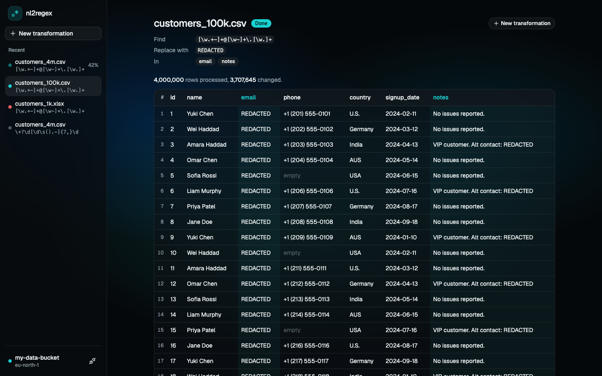

# nl2regex-platform

Natural-language data transformation at scale. Connect your own S3 bucket, describe a pattern in plain
English, and an LLM-generated (and validated) regex is applied across millions of rows by PySpark,
asynchronously via Celery.

**Stack:** Django + DRF · React (Vite, TypeScript) · Celery · Redis · PySpark · Postgres


> Work in progress. So far, end to end: connect your S3 bucket, choose a file, preview it, give a
> regex and a replacement, pick the columns, and an asynchronous job has PySpark rewrite the file
> with live progress, cancellation, retries and paginated results. Natural-language patterns (LLM),
> the deployment URL and the demo video land here as the build progresses.

## Run

```sh
docker compose up --build
```

| Service | URL |
|---|---|
| UI | http://localhost:5173 |
| API health | http://localhost:8000/api/health/ |
| Flower (worker monitoring) | http://localhost:5555 |

No `.env` is needed for local development; compose supplies dev-only defaults. The first build
downloads about 1.2 GB (PySpark, a Java runtime and Spark's S3 connector) into an image of about
2 GB that every backend service shares.

## Architecture

The backend is four layers. Dependencies only point inward, and
[a test](backend/tests/test_architecture.py) fails the build if an import breaks that rule.

```
presentation     api/  tasks/     DRF views and Celery tasks. Both only translate and delegate.
                  │
service          services/        Use-cases. Standard library and domain imports only.
                  │
domain           domain/          Entities, errors, and ports (interfaces). Standard library only.
                  ▲
infrastructure   infrastructure/  S3 adapter, credential vault, job repository (Django ORM),
                                  Celery queue, transform engine, Parquet result store.
```

- **The domain defines what it needs** as `typing.Protocol` ports (`ObjectStorage`,
  `CredentialVault`, `JobRepository`, `TaskQueue`, `TransformEngine`, `ResultStore`).
  Infrastructure implements them, so boto3, Redis and Django never leak into
  the business rules, and the service layer is tested with small in-memory fakes.
- **`config/container.py` is the composition root.** It is the one place that wires real adapters
  into services. Views, and later Celery tasks, ask it for a service and never import
  infrastructure themselves.
- **Errors are domain objects.** Each has a stable `code` and a message that is safe to show.
  One handler maps them to HTTP statuses, so every API failure has the same shape:
  `{"error": {"code": "...", "message": "..."}}`.

### Jobs: the asynchronous pipeline

`POST /api/jobs/` validates the request, saves a `QUEUED` job and returns `202` with its ID in a few
milliseconds. A Celery worker does the work and the browser polls.

| Endpoint | Behaviour |
|---|---|
| `POST /api/jobs/` | Body `{file_key, pattern, replacement, columns}`. `202` with the job. Rate limited. |
| `GET /api/jobs/` · `GET /api/jobs/{id}/` | This connection's jobs: status, progress, stage, error, row counts. |
| `POST /api/jobs/{id}/cancel/` | A queued job is cancelled at once. A running one has its Spark job cancelled, within a second. |
| `GET /api/jobs/{id}/rows/?page=&page_size=` | One page of the result. `409` until the job succeeds. |
| `GET /api/connection/files/preview/?key=` | Column names and first rows, read by a worker. Poll until `done`. |

- **The state machine lives on the `Job` entity** (`QUEUED`, `RUNNING`, `SUCCESS`, `FAILED`,
  `CANCELLED`), and every status change is persisted as a compare-and-set:
  `UPDATE ... WHERE id = ? AND status = ? AND attempts = ?`. Two workers, or a cancel racing a
  finish, cannot both win, and no locks are needed.
- **A job belongs to the connection that created it.** Another browser gets a 404, and
  disconnecting cancels that connection's jobs and deletes their output.
- **Workers receive IDs only.** Task arguments are visible in Flower and in the event stream, so
  credentials never travel that way. A worker looks them up in the vault by connection ID.
- **Results are Parquet**, written in row groups of about 1 MB. A page read finds its row group
  from the file footers and reads only that group, so page latency does not grow with the result
  (measured: 13 ms for the first page and for the last page of 4,000,000 rows).
- **Every cell is text, and the replacement is literal.** A cleaning tool must not alter cells it
  was not asked to touch, so `00123` never becomes `123`, and `$1` in a replacement is just `$1`.

**How failures are handled** (behaviour checked against Celery's source and on the running stack):

| Failure | What happens |
|---|---|
| S3 is unreachable | The job returns to `QUEUED` and Celery retries it with exponential backoff, three attempts at most. |
| Bad credentials, a missing column, an unreadable file | The job fails at once with a message the user can act on. No retry. |
| A worker process dies mid-job (`kill -9`, out of memory) | Late acknowledgement makes the broker redeliver the message. The redelivered task takes the job over as a new attempt and starts from a clean output folder. |
| A job kills its worker every time | An attempt cap of three stops the loop. |
| The soft time limit | The task fails its job cleanly with `timed_out`. |
| The hard time limit (code that cannot be interrupted) | Celery kills the process and acknowledges the message, so nothing redelivers it. A job still `RUNNING` past the visibility timeout is marked failed the next time it is read. |
| The same message reaches two workers | The compare-and-set lets one start. The other sees no row change and stops. |
| S3 drops out while Spark is reading | Spark's own retries run out, the Java error is translated to "could not reach S3", and the job takes the retry path in the first row. |
| A regex that Python accepts and Java does not | The job fails with `invalid_pattern` and Java's own explanation, before any data is read. |
| A regex that backtracks forever | Cancel works: stopping the Spark application kills the stuck match. (A guard that refuses such patterns up front arrives with the LLM integration.) |

### The Spark engine: partitioning and parallelism

`TransformEngine` is a port with two implementations. `SparkEngine` does the work. `StreamingEngine`
rewrites a file in one Python process; it is the reference the Spark engine is tested against, and
`TRANSFORM_ENGINE=streaming` switches to it if a JVM is not an option.

**The plan is map-only.** Every row is independent of every other, so there is nothing to join,
group or sort, and therefore nothing to shuffle:

```
s3a://bucket/key ─▶ 32 MB splits ─▶ regexp_replace on the target columns ─▶ one Parquet part per split
                    (one task each)   (inside the JVM, all partitions at once)
```

- **The file is read straight from S3** with Hadoop's `s3a` connector. Each task fetches its own
  byte range, so reading scales with the number of cores, not with one download stream.
- **32 MB splits, not Spark's 128 MB default.** Rows stream through a task, so memory is not what
  decides this. Smaller tasks give smoother progress ("7 of 13 partitions"), make a failed task
  cheap to retry and balance better across cores. Measured on 2 million rows, split sizes from 8 MB
  to 128 MB changed the run time by less than 10%, so the smaller size costs next to nothing.
- **The regex is Spark's built-in `regexp_replace`, not a Python UDF.** A built-in compiles into the
  JVM code Spark generates for the stage. A Python UDF would serialise every row out to a Python
  process and back. It also means executors need no Python at all.
- **Counting costs no second pass.** Rows processed and rows changed come from Spark's
  `Observation` API, which collects aggregates while the write itself runs.
- **Row order is kept.** Splits become partitions in file order and part files sort the same way,
  so row 1 of the result is row 1 of the file. A test pins this, because it is Spark's behaviour
  and not its contract.
- **One Spark application per job**, in a worker process that handles one task and is then
  replaced. Hadoop caches S3 clients per bucket name for the life of a JVM, and that cache ignores
  credentials, so a long-lived JVM could read one user's bucket with another user's keys. Here the
  JVM, the keys in it and its caches all end with the job. The JVM is a child of the worker process
  and exits when that process does, including after `kill -9`. The price is about 3 seconds of
  start-up per job.

**Java's regex engine is pinned to Python's semantics.** The pattern is checked by Python when it
is submitted and compiled again in the JVM when the job starts. Two inline flags are prefixed:
`(?U)` makes `\w`, `\d`, `\b` and case-insensitive matching Unicode-aware, as they are in
Python, so `\w+` matches "Zoë"; `(?d)` makes `\n` the only line terminator. Measured cost: none
(6.1 s with the flags, 6.0 to 6.3 s without, on 2 million rows). In the replacement, `\` and `$`
are escaped, because Java would read `$1` as a group reference.

**A CSV can only be split safely if no cell contains a line break,** and from the middle of a file
nobody can tell whether a newline sits inside quotes. Spark's `multiLine` reader is always correct
but reads the whole file in one task. So the engine reads optimistically and checks its own work:

1. The first pass uses the splittable reader.
2. A cell with a line break then falls apart into fragments, and each fragment holds one half of a
   pair of quotes. Either Spark flags the fragment as malformed and its raw text has an odd number
   of quotes, or, when the broken cell is in the last column and both fragments happen to have the
   right number of cells, the closing quote is left inside the last cell. Both are counted by the
   same `Observation`, during the same write, so the check is free.
3. Only if that count is not zero is the file read again with `multiLine`, and the job's stage says
   so. A false alarm, such as an unescaped inch mark, costs the second pass and nothing else.

**Excel is converted to Parquet first.** Spark has no Excel reader, and an `.xlsx` is a zip archive
that cannot be split. The worker streams the first sheet into a Parquet file beside the results and
Spark takes over from there, so both formats share one pipeline. A sheet tops out at 1,048,576
rows, so this step is never the scale problem.

Measured on the compose stack with Spark on two cores: 4,000,000 rows (404 MB) in 12.9 s from
submit to done, against 14.9 s for the single-process engine, with identical row counts.

### Frontend

React 19 with TypeScript, Tailwind CSS 4 and [shadcn/ui](https://ui.shadcn.com) components, in a
dark theme driven by one set of CSS variables in `src/index.css`.

```
src/components/ui/   shadcn primitives, plus prompt-input.tsx (the composer)
src/components/      the app shell
src/features/        connection/, files/ and composer/: each owns its API calls and screens
src/lib/             the fetch wrapper (typed ApiError) and small helpers
```

- **One screen, one flow.** The composer's action button walks through the steps: *Connect S3
  bucket*, then *Choose file*, then the chosen file sits in the composer as a chip and a worker
  reads its first rows. The preview's column headers are the column picker: click to target a
  column, or leave them all unselected to apply the pattern everywhere.
- **A job page per job**, at `/jobs/:id`, so a refresh keeps your place and the sidebar's items are
  real links. It polls every second while the job is queued or running and stops when it ends.
  Routing is the browser's History API; two routes do not need a library.
- **Results never arrive all at once.** The table asks for one page, keeps showing it while the next
  loads, and offers 25, 50 or 100 rows per page.
- **Server state lives in TanStack Query.** A 401 from any request flips the app back to "not
  connected", so an expired connection is handled in one place.
- **The secret key never enters React state.** The connect form is an uncontrolled native form,
  read once with `FormData` on submit and then reset. The submit is a plain async function rather
  than a TanStack mutation, because mutations keep their variables in a cache for minutes.

| A job running | Its results |
|---|---|
|  |  |


## How your AWS credentials are handled

You connect with your own access key, secret key and bucket name. This is what happens to them.

| Concern | What the app does |
|---|---|
| Validation | The keys are checked against S3 before anything is stored. A failed attempt stores nothing. |
| Storage | They are encrypted with Fernet (AES-128-CBC with an HMAC) and kept in Redis only. They are never written to Postgres or to disk by the app. The encryption key lives in the app's environment, so a Redis dump alone is useless. |
| Expiry | A connection is forgotten after 1 hour without use, and after 8 hours regardless. **Disconnect** deletes it at once. |
| API responses | No endpoint returns the keys. The connect response contains only the bucket name and its region. |
| Your browser's handle | A random token in an `HttpOnly`, `SameSite=Strict`, `Secure` cookie. It never appears in a URL or an access log, and JavaScript cannot read it. The server stores only the token's SHA-256, so leaked server data contains nothing a browser could replay. |
| Logs | Keys are never logged. The credentials object masks itself in `repr`, the AWS SDK loggers are pinned above the level at which they print request headers, and a failed connect logs only the AWS error code, request ID and bucket name. |
| Background jobs | Workers receive a connection ID and look the keys up themselves. Keys are never passed as Celery task arguments, which Flower and the result backend would display. |
| Inside Spark | The keys are set on one job's Spark session at runtime, so they are never in the Spark configuration, on a command line or in an event log, and Spark redacts them on its UI pages. The provider is pinned to `SimpleAWSCredentialsProvider`: the default chain falls back to the machine's own identity if the keys are ever empty (checked: it does), and the pin refuses instead. The bridge between Python and the JVM is kept above the log level at which it prints the calls it relays. |
| Abuse | Connect attempts are rate limited per client, so the endpoint cannot be used to test stolen keys in bulk. The API accepts JSON only, which blocks cross-site form posts from connecting a visitor's browser to someone else's bucket. |

Errors are specific: wrong keys, a bucket that doesn't exist, keys without permission on the
bucket, and S3 being unreachable each produce their own message.

### Minimum IAM policy

The app only ever reads. This is all it needs, and it is what the project itself is tested with:

```json
{
  "Version": "2012-10-17",
  "Statement": [
    { "Effect": "Allow", "Action": "s3:ListBucket", "Resource": "arn:aws:s3:::YOUR_BUCKET" },
    { "Effect": "Allow", "Action": "s3:GetObject", "Resource": "arn:aws:s3:::YOUR_BUCKET/*" }
  ]
}
```

The bucket can be in any region. The app discovers the region when you connect.

## Tests

```sh
cd backend
uv run pytest        # needs no Docker, database server or AWS account
uv run ruff check .
```

Tests use in-memory caches, SQLite and a fake S3 ([moto](https://github.com/getmoto/moto)), and the
same commands run in CI on every pull request. The task layer is tested by running the real Celery
tasks against the real repository and result store.

The engine tests run every case on both engines, so each one also checks that Spark and the
reference engine agree, and a differential test compares their output on messy generated data. They
start Spark in local mode, which needs Java 17 or 21. Where no such Java is found they are skipped
with a message; in CI a skip is a failure.

`scripts/make_sample_data.py` generates a deterministic, deliberately messy customer dataset (CSV or
Excel, any row count) for demos and benchmarks.
