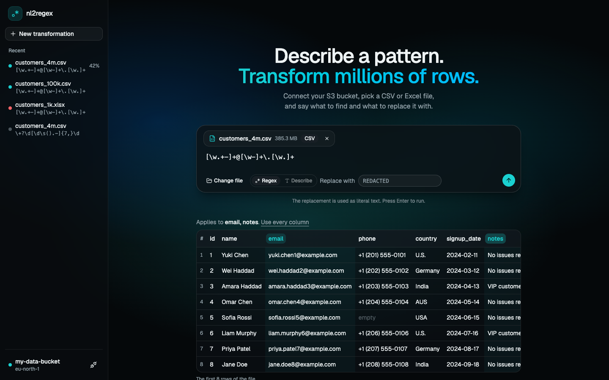
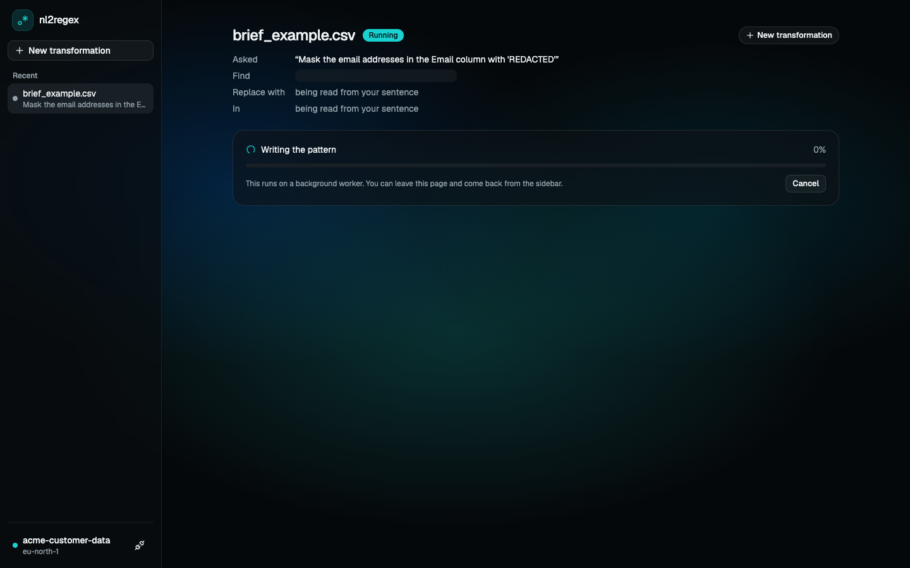
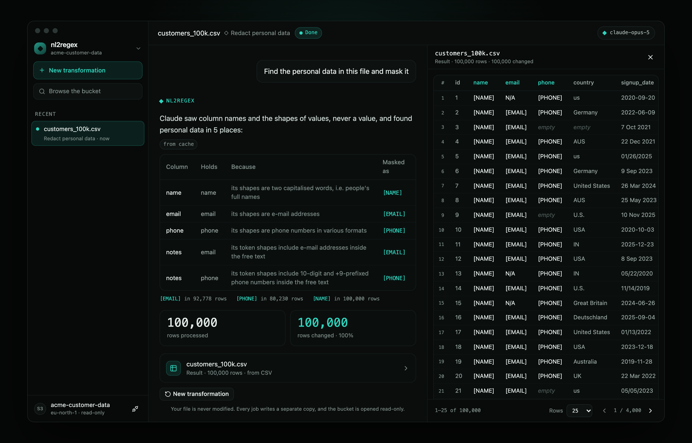
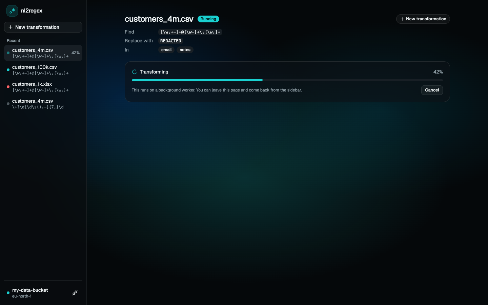
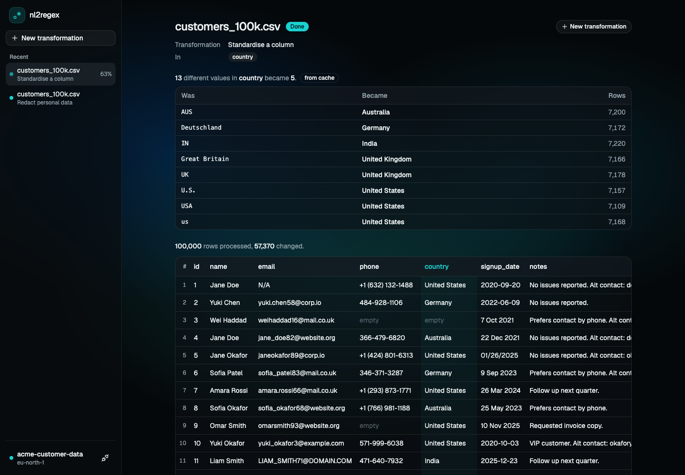
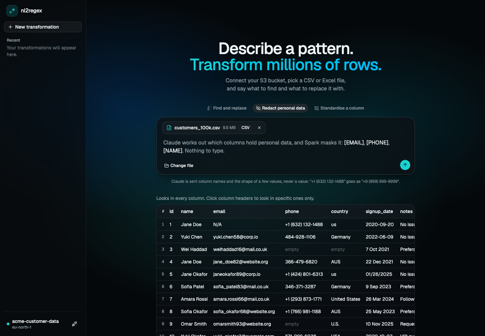
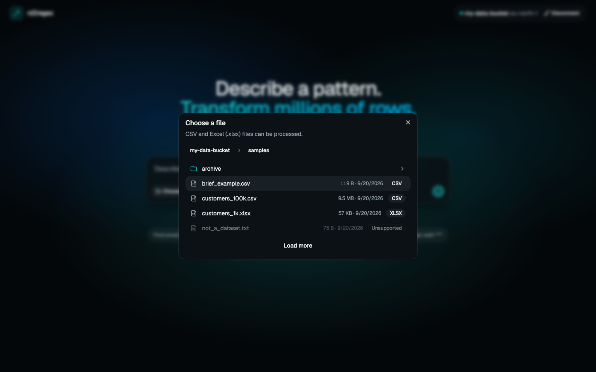

# nl2regex-platform

Natural-language data transformation at scale. Connect your own S3 bucket, describe a pattern in plain
English, and an LLM-generated (and validated) regex is applied across millions of rows by PySpark,
asynchronously via Celery.

**Stack:** Django + DRF · React (Vite, TypeScript) · Celery · Redis · PySpark · Postgres



> Work in progress. So far, end to end: connect your S3 bucket, choose a file, preview it, describe
> what to find in plain English (or type a regex), and an asynchronous job has Claude write and
> check the pattern and PySpark rewrite the file, with live progress, cancellation, retries and
> paginated results. Two more transformations run through the same pipeline: redacting personal
> data automatically, and standardising a messy column. The deployment URL and the demo video
> land here as the build progresses.

## Run

```sh
docker compose up --build
```

**One port is published, and everything is reached through it**, as it will be in production.
Postgres, Redis, the API and the Spark cluster are on the compose network only.

| Service | URL |
|---|---|
| UI | http://localhost:5173 |
| API health | http://localhost:5173/api/health/ |
| Flower (Celery workers, queues, tasks) | http://localhost:5173/flower/ |
| Spark cluster (its workers and applications) | http://localhost:5173/spark/ |
| Spark job (stages and tasks, only while a job runs) | http://localhost:5173/spark-job/ |

No `.env` is needed for local development; compose supplies dev-only defaults. To describe patterns
in plain English, put `ANTHROPIC_API_KEY=...` in a git-ignored `.env` beside `docker-compose.yml`.
Without it that mode is switched off, with an explanation, and everything else works. The first build
downloads about 1.2 GB (PySpark, a Java runtime and Spark's S3 connector) into an image of about
2 GB that every backend service shares. Everything below was measured with Docker limited to 8 GB
of memory; on a smaller machine, `SPARK_MASTER_URL=local[2] docker compose up` runs Spark inside
the job worker instead of on the cluster, with the same engine.

## Architecture

The backend is four layers. Dependencies only point inward, and
[a test](backend/tests/test_architecture.py) fails the build if an import breaks that rule.

```
presentation     api/  tasks/     DRF views and Celery tasks. Both only translate and delegate.
                  │
service          services/        Use-cases. Standard library and domain imports only.
                  │
domain           domain/          Entities, errors, and ports (interfaces). Standard library only.
                  ▲
infrastructure   infrastructure/  S3 adapter, credential vault, job repository (Django ORM),
                                  Celery queue, transform engine, Parquet result store.
```

- **The domain defines what it needs** as `typing.Protocol` ports (`ObjectStorage`,
  `CredentialVault`, `JobRepository`, `TaskQueue`, `TransformEngine`, `ResultStore`).
  Infrastructure implements them, so boto3, Redis and Django never leak into
  the business rules, and the service layer is tested with small in-memory fakes.
- **`config/container.py` is the composition root.** It is the one place that wires real adapters
  into services. Views, and later Celery tasks, ask it for a service and never import
  infrastructure themselves.
- **Errors are domain objects.** Each has a stable `code` and a message that is safe to show.
  One handler maps them to HTTP statuses, so every API failure has the same shape:
  `{"error": {"code": "...", "message": "..."}}`.

### Jobs: the asynchronous pipeline

`POST /api/jobs/` validates the request, saves a `QUEUED` job and returns `202` with its ID in a few
milliseconds. A Celery worker does the work and the browser polls.

| Endpoint | Behaviour |
|---|---|
| `POST /api/jobs/` | Body `{replacement, columns}` with either `file_key` or `source_job_id` (a follow-up on an earlier result), plus either `pattern` or `prompt`. `kind` selects the transformation: `replace` (the default), `redact_pii`, or `standardise` (exactly one column, and `prompt` as an optional instruction). `202` with the job. Rate limited. |
| `GET /api/jobs/` · `GET /api/jobs/{id}/` | This connection's jobs: status, progress, stage, error, row counts. |
| `POST /api/jobs/{id}/cancel/` | A queued job is cancelled at once. A running one has its Spark job cancelled, within a second. |
| `GET /api/jobs/{id}/rows/?page=&page_size=` | One page of the result. `409` until the job succeeds. |
| `GET /api/connection/files/preview/?key=` | Column names and first rows, read by a worker. Poll until `done`. |
| `GET /api/config/` | Whether this server can turn a prompt into a pattern, so the UI offers only what works. |

- **The state machine lives on the `Job` entity** (`QUEUED`, `RUNNING`, `SUCCESS`, `FAILED`,
  `CANCELLED`), and every status change is persisted as a compare-and-set:
  `UPDATE ... WHERE id = ? AND status = ? AND attempts = ?`. Two workers, or a cancel racing a
  finish, cannot both win, and no locks are needed.
- **A job belongs to the connection that created it.** Another browser gets a 404, and
  disconnecting cancels that connection's jobs and deletes their output.
- **Workers receive IDs only.** Task arguments are visible in Flower and in the event stream, so
  credentials never travel that way. A worker looks them up in the vault by connection ID.
- **Results are Parquet**, written in row groups of about 1 MB. A page read finds its row group
  from the file footers and reads only that group, so page latency does not grow with the result
  (measured: 13 ms for the first page and for the last page of 4,000,000 rows).
- **Every cell is text, and the replacement is literal.** A cleaning tool must not alter cells it
  was not asked to touch, so `00123` never becomes `123`, and `$1` in a replacement is just `$1`.

**How failures are handled** (behaviour checked against Celery's source and on the running stack):

| Failure | What happens |
|---|---|
| S3 is unreachable | The job returns to `QUEUED` and Celery retries it with exponential backoff, three attempts at most. |
| Bad credentials, a missing column, an unreadable file | The job fails at once with a message the user can act on. No retry. |
| A worker process dies mid-job (`kill -9`, out of memory) | Late acknowledgement makes the broker redeliver the message. The redelivered task takes the job over as a new attempt and starts from a clean output folder. |
| A job kills its worker every time | An attempt cap of three stops the loop. |
| The soft time limit | The task fails its job cleanly with `timed_out`. |
| The hard time limit (code that cannot be interrupted) | Celery kills the process and acknowledges the message, so nothing redelivers it. A job still `RUNNING` past the visibility timeout is marked failed the next time it is read. |
| The same message reaches two workers | The compare-and-set lets one start. The other sees no row change and stops. |
| S3 drops out while Spark is reading | Spark's own retries run out, the Java error is translated to "could not reach S3", and the job takes the retry path in the first row. |
| A regex that Python accepts and Java does not | The job fails with `invalid_pattern` and Java's own explanation, before any data is read. |
| A regex that backtracks forever | Refused before any data is read, whether Claude wrote it or a person typed it: `unsafe_pattern`, quoting the input that hung it. If one ever slips through, Cancel still works, because stopping the Spark application kills the stuck match. |
| Claude is unreachable, rate limited or overloaded | The SDK retries twice, then the job takes the retry path in the first row and ends as `llm_unavailable`. |
| The request is not about finding anything ("what is the weather today") | The job fails as `pattern_not_understood`, with Claude's own reason. |
| Claude cannot write a pattern that passes the checks in three attempts | The job fails as `pattern_not_verified` and says which check failed. A wrong pattern is never run. |
| A column chosen for standardising is not a set of categories | `not_categorical`, after the counting pass and before anything is sent to Claude. |
| Claude finds no personal data, or the values are already consistent | `nothing_to_change`, with a plain message. No copy of the file is written for nothing. |
| A Spark worker dies mid-job | Spark reschedules its tasks on the workers that are left. Checked by killing one of two worker containers at 25%: the job succeeded on its first attempt with the same row counts, in 22 s instead of 16 s. |
| The Spark master cannot be reached | The driver gives up after a minute, the job shows "Retrying: The processing cluster could not be reached", and after three attempts it fails with `engine_unavailable`. Workers re-register by themselves when the master returns. |

### From plain English to a pattern

> *"Find email addresses in the Email column and replace them with 'REDACTED'."*

That sentence, from the brief, is a complete request here. The job is queued at once, and its
worker's first stage is *Writing the pattern*: the call to Claude is heavy work, so it belongs in
the Celery task and never in a web request.

- **Only the sentence goes to Claude.** No column names, no sample rows. A tool whose main use is
  redacting personal data should not send that data to a third party in order to do it. A test
  replaces the network at the wire and pins the request's shape, so sending anything more would
  have to be done on purpose. It also makes the answer a pure function of the sentence, which is
  what makes it cacheable.
- **The answer is a structured object,** not text. Structured outputs constrain decoding to a
  schema, so a regex arrives with its backslashes intact, which asking for "JSON with a regex in
  it" does not guarantee. Besides the pattern it holds a one-line explanation, the replacement and
  the columns *if the sentence states them*, and a few strings that should and should not match.
  Whatever you fill in yourself wins over the sentence. "The Email column" finds a column called
  `email`: names are matched exactly first, then ignoring case, spaces and underscores, and a name
  that matches nothing fails the job by name instead of quietly meaning "every column".
- **Claude's pattern is not trusted.** Before it is used it has to:
  1. compile, and avoid syntax that Python accepts and Java does not;
  2. **pass the examples Claude wrote for it**, which catches a pattern that is wrong somewhere
     (in a trial, a phone pattern missed two of its own five examples);
  3. survive a **timed dry run in a child process that can be killed**.

  A failure goes back to Claude with the reason, including what matched where, at most twice.
  Then the job fails with that reason. Only a pattern that passed is cached or run.
- **The dry run is how catastrophic backtracking is caught.** A backtracking regex engine cannot
  be interrupted from inside, in Python or in Java. So the pattern is tried in a child process on
  runs of its own characters with an ending that spoils the match (`aaaa…a!`, `1111…!`,
  `a a a …!`), and the child is killed at two seconds. It is tuned so that `\s+$`, which is
  quadratic and harmless, passes, and cubic or exponential patterns do not: `(a+)+$`,
  `(.*a){12}$`, and OWASP's e-mail example are all refused. Typed patterns get the same check.
  Measuring behaviour also avoids the false alarms of a syntactic rule: Claude's e-mail pattern
  contains `(?:\.[\w-]+)*`, a nested quantifier that is perfectly linear. The inputs are a
  heuristic, and the code says so; behind them, Cancel and the job's time limit still apply.
- **Redis caches the verified answer** for 30 days, keyed by the sentence after lower-casing,
  collapsing whitespace and dropping a final full stop, together with the model and the version
  of the instructions. The job records whether its pattern came from `llm`, `cache` or `user`.
  Checked on the running stack: the brief's sentence run twice made one API call.

**The model was chosen by measurement.** `scripts/eval_prompts.py` sends 42 requests, several
phrasings each of 17 kinds of thing to find, through the whole pipeline with the cache off. A
request passes when its pattern finds every string it should, finds nothing in those it should not,
and replaces exactly the expected span.

| Model | Passed | API calls (with repairs) | Median | 90th percentile |
|---|---|---|---|---|
| `claude-haiku-4-5` | 23 / 42 | 79 | 3.9 s | 9.4 s |
| `claude-sonnet-5` | 41 / 42 | 50 | 3.7 s | 8.7 s |
| `claude-opus-5` (default) | **42 / 42** | 46 | 5.0 s | 11.5 s |

The default is the one that passed everything; `LLM_MODEL` changes it, and Sonnet is the choice if
a second of latency matters more than the last request in forty. Sonnet's one miss failed safe,
as `pattern_not_verified`. The same script is how the instructions were improved: a first version
scored 32 and 35 out of 39 on Sonnet and Opus, and its failures showed why (a `\b` placed next to
`(` or `$`, and negative examples that contained a valid match inside them).

### Two more transformations: redact personal data, standardise a column

The brief asks for two more LLM transformations "through the same async/Spark pipeline". Both are
the same kind of job as a find-and-replace: `202` at once, a Celery task, one Spark application,
progress, cancel, retries, takeover, paged results. Both obey one rule:

> **Claude is never called per row, and never sees rows in bulk.** It works on something the size
> of the *schema* or of a column's *distinct values*. Spark does the work that is the size of the
> *data*. A model call per row on ten million rows would take days and cost thousands of dollars.

**Redact personal data** (`kind: redact_pii`). No pattern and no sentence. Claude says which
columns hold personal data and of what kind, and Spark masks it with typed placeholders.

- **Claude is shown shapes, never values.** Every letter becomes `a` and every digit `9`:
  `john.doe@example.com` is sent as `aaaa.aaa@aaaaaaa.aaa`, and `+1 (632) 132-1488` as
  `+9 (999) 999-9999`. Punctuation and length are what make an e-mail address or a phone number
  recognisable, and they identify nobody. A test replaces the network at the wire and checks that
  no word of any sampled value is in the request.
- **Whole-value shapes miss what is buried in free text,** where every sentence has a shape of
  its own. So the shapes of the non-word *tokens* inside values are sent too, which is how
  `aaaa99@aaaa.aa` shows up for a `notes` column. Near-identical shapes share a place, so that
  e-mail addresses of forty different lengths do not crowd out the phone numbers beside them.
  Both were found by trying it: the first version missed the e-mails in `notes`, the second the
  phone numbers.
- **Claude classifies; our patterns redact.** For e-mail, phone, SSN, card number, IP address and
  URL the regex comes from a small library, each pattern tested and run through the safety probe.
  A name cannot be found by a regex, so a column classified as names is masked cell by cell. For
  anything else Claude may write a pattern, and it goes through the same checks as any other.
- On the 100,000-row sample: `name`, `email` and `phone` were found, `notes` was flagged for the
  e-mail addresses and the phone numbers inside it, and `id`, `country` and `signup_date` were
  left alone. The job page reports each operation with the rows it changed.

**Standardise a column** (`kind: standardise`). `USA`, `U.S.`, `us` and `United States` become one
value. A regex cannot do this: knowing that `Deutschland` is `Germany` is knowledge.

```
pass 1  groupBy(column).count()      the project's one shuffle, and a small one: counts are combined
                                     on each partition first, so at most (values x partitions) rows move
        Claude maps each spelling    one call, on a few hundred strings
pass 2  broadcast join, map-only     the mapping is copied to every executor; the file's rows are
                                     never shuffled to meet it, and they keep their order
```

- **Claude is sent the distinct values of the one column you chose,** and the UI says so first.
  A column with more than 300 values, or values longer than 60 characters, is not a set of
  categories. It is names or e-mail addresses, and the job refuses it *before anything is sent*.
  The limit is a privacy guard first and a cost guard second.
- **The answer is not trusted.** A key Claude invented is dropped, as is an entry that changes
  nothing. Blanks stay blank, and values outside the mapping stay as they are.
- A broadcast join, not a literal map expression: a map literal is scanned key by key for every
  row, while the join is one hash lookup. The file is read from S3 twice, because caching ten
  million rows in executor memory to avoid that would cost more than it saves.
- On the sample: 13 spellings of 5 countries became 5 values, and the report's row counts, which
  come free from pass 1, add up to exactly the 57,370 rows that pass 2 changed.

Both answers are cached in Redis under a hash of exactly what was sent. Checked on the stack: a
repeated job, and a job taken over after `kill -9`, made no second call to Claude.

**One engine change serves all three.** An engine used to `run(job)`. It now opens the file for
the length of the job and returns something that can `sample()` the first rows, count
`distinct_values(column)`, and `rewrite(operations)`, where an operation is `Replace`, `MaskCells`
or `MapValues`. A find-and-replace job is simply `[Replace(...)]`. One Spark application still
serves the whole job, and it starts at the first pass, so a job does not hold cluster cores while
Claude is thinking. The reference engine implements the same interface, so every case still runs
on both, and that is what caught a real bug: given positional `?` parameters, PySpark 4.1 bound
the lookup table's values in reverse, which turned `AUS → Australia` into `us → AUS` without any
error. The values are now bound by name.

### What runs where

```
browser ─▶ web (Django API) ──┬─▶ Postgres   jobs and their state
                              └─▶ Redis      broker · results · cache · encrypted credential vault
                                    │
             queue "celery" ◀───────┴───────▶ queue "jobs"
                    │                               │
             worker (previews)               worker-jobs: one Celery task = the DRIVER of one
                                             Spark application, started for that job alone
                                                    │
                                             spark-master ─▶ spark-worker × 2 (2 cores each)
                                                               executors read s3a:// directly
                                                               and write Parquet to a volume
                                                               that web reads pages from
```

- **Jobs have their own queue and worker.** A Spark application takes cores from the cluster, so
  how many jobs run at once is a capacity decision, not a side effect of Celery's concurrency. The
  default is one job at a time with the whole cluster to itself; the next one waits as `QUEUED`,
  which is the truth. With `JOB_CONCURRENCY=N`, set `SPARK_CORES_MAX` to each job's share of the
  cores, or the first job takes them all.
- **Previews never wait behind a job.** They run on the other worker (checked: a preview answered
  in 0.2 s while one job was running and another was queued).
- **To scale out,** add Spark workers: `docker compose up -d --scale spark-worker=4`. Nothing else
  changes, because the engine only knows the master's URL.

### The Spark engine: partitioning and parallelism

`TransformEngine` is a port with two implementations. `SparkEngine` does the work. `StreamingEngine`
rewrites a file in one Python process; it is the reference the Spark engine is tested against, and
`TRANSFORM_ENGINE=streaming` switches to it if a JVM is not an option.

**The plan is map-only.** Every row is independent of every other, so there is nothing to join,
group or sort, and therefore nothing to shuffle:

```
s3a://bucket/key ─▶ 32 MB splits ─▶ regexp_replace on the target columns ─▶ one Parquet part per split
                    (one task each)   (inside the JVM, all partitions at once)
```

- **The file is read straight from S3** with Hadoop's `s3a` connector. Each task fetches its own
  byte range, so reading scales with the number of cores, not with one download stream.
- **32 MB splits, not Spark's 128 MB default.** Rows stream through a task, so memory is not what
  decides this. Smaller tasks give smoother progress ("7 of 13 partitions"), make a failed task
  cheap to retry and balance better across cores. Measured on 2 million rows, split sizes from 8 MB
  to 128 MB changed the run time by less than 10%, so the smaller size costs next to nothing.
- **The regex is Spark's built-in `regexp_replace`, not a Python UDF.** A built-in compiles into the
  JVM code Spark generates for the stage. A Python UDF would serialise every row out to a Python
  process and back. It also means executors need no Python at all.
- **Counting costs no second pass.** Rows processed and rows changed come from Spark's
  `Observation` API, which collects aggregates while the write itself runs.
- **Row order is kept.** Splits become partitions in file order and part files sort the same way,
  so row 1 of the result is row 1 of the file. A test pins this, because it is Spark's behaviour
  and not its contract.
- **One Spark application per job**, in a worker process that handles one task and is then
  replaced. Hadoop caches S3 clients per bucket name for the life of a JVM, and that cache ignores
  credentials, so a long-lived JVM could read one user's bucket with another user's keys. Here the
  JVM, the keys in it and its caches all end with the job. The JVM is a child of the worker process
  and exits when that process does, including after `kill -9`. The price is about 4 seconds of
  start-up per job, and up to 5 more before a worker slot takes its next job, because Celery
  looks for finished processes on a 5-second timer. The engine also clears Hadoop's cache itself,
  so raising `--max-tasks-per-child` trades the second cost away without reopening the hole.

**Java's regex engine is pinned to Python's semantics.** The pattern is checked by Python when it
is submitted and compiled again in the JVM when the job starts. Two inline flags are prefixed:
`(?U)` makes `\w`, `\d`, `\b` and case-insensitive matching Unicode-aware, as they are in
Python, so `\w+` matches "Zoë"; `(?d)` makes `\n` the only line terminator. Measured cost: none
(6.1 s with the flags, 6.0 to 6.3 s without, on 2 million rows). In the replacement, `\` and `$`
are escaped, because Java would read `$1` as a group reference.

**A CSV can only be split safely if no cell contains a line break,** and from the middle of a file
nobody can tell whether a newline sits inside quotes. Spark's `multiLine` reader is always correct
but reads the whole file in one task. So the engine reads optimistically and checks its own work:

1. The first pass uses the splittable reader.
2. A cell with a line break then falls apart into fragments, and each fragment holds one half of a
   pair of quotes. Either Spark flags the fragment as malformed and its raw text has an odd number
   of quotes, or, when the broken cell is in the last column and both fragments happen to have the
   right number of cells, the closing quote is left inside the last cell. Both are counted by the
   same `Observation`, during the same write, so the check is free.
3. Only if that count is not zero is the file read again with `multiLine`, and the job's stage says
   so. A false alarm, such as an unescaped inch mark, costs the second pass and nothing else.

**Excel is converted to Parquet first.** Spark has no Excel reader, and an `.xlsx` is a zip archive
that cannot be split. The worker streams the first sheet into a Parquet file beside the results and
Spark takes over from there, so both formats share one pipeline. A sheet tops out at 1,048,576
rows, so this step is never the scale problem.

**Measured**, from submit to done, on the compose stack (Docker on an Apple-silicon laptop, 8 GB,
an S3-compatible server in the same Docker network). The job redacts email addresses in two of
seven columns. Every run of a file produced the same row counts on both engines.

| File | Single process (1 core) | Spark, 2 cores | Spark, 4 cores (default) | Spark, 6 cores |
|---|---|---|---|---|
| 100,000 rows, 10 MB | **0.5 s** | | 6.6 s | |
| 4,000,000 rows, 404 MB | 15.5 s | 12.9 s ¹ | **10.6 to 11.6 s** | |
| 10,000,000 rows, 1.01 GB | 38.1 s | 23.4 s | 16.1 s | **13.2 to 14.6 s** |

¹ Spark in local mode inside the job worker. Every other Spark figure is on the standalone cluster.
A range is the spread over repeated runs.

- **Spark pays about 4 seconds before the first row**, so it loses on small files and wins from a
  few million rows up. Routing small files to the single-process engine would be the obvious
  production optimisation; it is left out so that every job here really runs on Spark.
- **Scaling is sublinear at this size** because each executor is a fresh JVM: its first seconds go
  to compiling the generated code, a fixed cost that a 12-second job feels and a 10-minute job
  would not. The executors, not S3 and not the driver, were the busy containers (each at about
  200% CPU on its two cores).
- The last page of the 10-million-row result (row 10,000,000, spread over 32 part files) came back
  in 17 ms.

### Frontend

React 19 with TypeScript, Tailwind CSS 4 and [shadcn/ui](https://ui.shadcn.com) primitives, built
as a **desktop client**: one window on a near-black page, a sidebar, a title bar, and the work in
the middle. The palette, spacing and radii come from a single design, and the type is Instrument
Sans with Instrument Serif for the one hero line and JetBrains Mono for data, labels and patterns.
All of it is CSS variables in `src/index.css`.

```
src/components/ui/   shadcn primitives, plus prompt-input.tsx (the composer)
src/components/      the app shell
src/features/        connection/, files/, composer/, jobs/ and config/: each owns its API calls and screens
src/lib/             the fetch wrapper (typed ApiError) and small helpers
```

- **One screen, one flow.** The composer's action button walks through the steps: *Connect S3
  bucket*, then *Choose file*, then the chosen file sits in the composer as a chip and a worker
  reads its first rows. The preview's column headers are the column picker: click to target a
  column, or leave them all unselected to apply the pattern everywhere.
- **Describe, or Regex.** The composer opens in Describe mode, where the request is a sentence,
  and says under the box that only the sentence is sent, never the data. Regex mode takes a
  typed pattern. Each mode keeps its own text, because a sentence is not a regex. On a server
  without an API key, Describe is disabled and says why.
- **Three transformations, one composer.** *Find and replace* (Describe or Regex), *Redact
  personal data* and *Standardise a column*. Each says what will be sent to Claude before
  anything is: for redaction, with a real value from the preview and the shape that goes in its
  place ("+1 (632) 132-1488" goes as "+9 (999) 999-9999"); for standardising, by naming the one
  column whose values are sent. Standardising takes exactly one column, so its picker is
  single-select and the send button waits for it.
- **The job page shows its work:** what was asked, the pattern Claude wrote with a *written by
  Claude* or *from cache* badge, and a one-line explanation of what it matches. While the pattern
  is being written that row is a skeleton, and the replacement and columns read "being read from
  your sentence", since the sentence may state them. For the other two transformations it shows
  a report as soon as Claude has answered, while Spark is still working: what was found, why,
  and how it was masked, or the mapping with the rows each spelling had. The rows each operation
  changed are filled in when the job ends, and only the columns it touched are tinted.
- **A job reads as a conversation**, at `/jobs/:id`: the request as it was made, then the answer —
  the pattern with its explanation, or the report of what Claude found — and then the numbers. It
  polls every second while the job runs and stops when it ends. Routing is the browser's History
  API; two routes do not need a library.
- **The rows are not a message.** They open in a panel beside the conversation, with its own
  footer to page through them, because a result is millions of rows long.
- **A follow-up runs on the last result**, not on the file again, so "now the phone numbers too"
  is one more turn in the same conversation. Each step writes its own copy and the original file
  is never touched. This is not in the brief; it is here because the interface is a conversation.
  A follow-up is refused unless the earlier job finished, produced rows, belongs to this
  connection and still has its result on disk.
- **Appearance and the connection live behind the workspace name**: system, dark or light, and
  connect or disconnect. Every colour is a token, so the light theme is a set of values.
- **A phone gets the same application, not a stacked page.** The sidebar becomes a drawer over the
  work, and the results a full-screen sheet that waits to be asked for.
- **Results never arrive all at once.** The table asks for one page, keeps showing it while the next
  loads, and offers 25, 50 or 100 rows per page.
- **Server state lives in TanStack Query.** A 401 from any request flips the app back to "not
  connected", so an expired connection is handled in one place.
- **The secret key never enters React state.** The connect form is an uncontrolled native form,
  read once with `FormData` on submit and then reset. The submit is a plain async function rather
  than a TanStack mutation, because mutations keep their variables in a cache for minutes.

| Claude writing the pattern | The result, in the panel beside the conversation |
|---|---|
|  |  |



| Redacting personal data | Standardising a column |
|---|---|
|  |  |





## How your AWS credentials are handled

You connect with your own access key, secret key and bucket name. This is what happens to them.

| Concern | What the app does |
|---|---|
| Validation | The keys are checked against S3 before anything is stored. A failed attempt stores nothing. |
| Storage | They are encrypted with Fernet (AES-128-CBC with an HMAC) and kept in Redis only. They are never written to Postgres or to disk by the app. The encryption key lives in the app's environment, so a Redis dump alone is useless. |
| Expiry | A connection is forgotten after 1 hour without use, and after 8 hours regardless. **Disconnect** deletes it at once. |
| API responses | No endpoint returns the keys. The connect response contains only the bucket name and its region. |
| Your browser's handle | A random token in an `HttpOnly`, `SameSite=Strict`, `Secure` cookie. It never appears in a URL or an access log, and JavaScript cannot read it. The server stores only the token's SHA-256, so leaked server data contains nothing a browser could replay. |
| Logs | Keys are never logged. The credentials object masks itself in `repr`, the AWS SDK loggers are pinned above the level at which they print request headers, and a failed connect logs only the AWS error code, request ID and bucket name. |
| Background jobs | Workers receive a connection ID and look the keys up themselves. Keys are never passed as Celery task arguments, which Flower and the result backend would display. |
| Inside Spark | The keys are set on one job's Spark session at runtime, so they are never in the Spark configuration, on a command line or in an event log, and Spark redacts them on its UI pages. The provider is pinned to `SimpleAWSCredentialsProvider`: the default chain falls back to the machine's own identity if the keys are ever empty (checked: it does), and the pin refuses instead. The bridge between Python and the JVM is kept above the log level at which it prints the calls it relays. |
| Across the cluster | The keys travel from the driver to the executors over Spark's RPC, so that RPC is authenticated with a shared secret (`SPARK_AUTH_SECRET`) and encrypted. Checked against a live cluster: the right secret runs a job, no secret is refused with `Expected SaslMessage`, and a wrong secret is refused too. Without authentication, anything that could reach the master's port could also run code on the workers. |
| Abuse | Connect attempts are rate limited per client, so the endpoint cannot be used to test stolen keys in bulk. The API accepts JSON only, which blocks cross-site form posts from connecting a visitor's browser to someone else's bucket. |

Errors are specific: wrong keys, a bucket that doesn't exist, keys without permission on the
bucket, and S3 being unreachable each produce their own message.

### Minimum IAM policy

The app only ever reads. This is all it needs, and it is what the project itself is tested with:

```json
{
  "Version": "2012-10-17",
  "Statement": [
    { "Effect": "Allow", "Action": "s3:ListBucket", "Resource": "arn:aws:s3:::YOUR_BUCKET" },
    { "Effect": "Allow", "Action": "s3:GetObject", "Resource": "arn:aws:s3:::YOUR_BUCKET/*" }
  ]
}
```

The bucket can be in any region. The app discovers the region when you connect.

## Limits

Anyone who can reach this server can spend its money and fill its disk. These are what stop
them. Each is a setting, so a deployment can choose its own.

| Limit | Default | Setting | Why this one |
|---|---|---|---|
| Connect attempts | 10 a minute per IP | — | The endpoint would otherwise test stolen AWS keys in bulk. |
| Submissions | 30 a minute per IP | — | Bounds the burst, not the bill. |
| Active jobs | 3 per connection | `JOB_MAX_ACTIVE_PER_CONNECTION` | One user cannot hold the whole cluster. |
| Jobs that call the model | 30 an hour per connection | `LLM_RATE_PER_CONNECTION` | Keeps one honest user from spending the budget. |
| Jobs that call the model | 200 a day, server-wide | `LLM_RATE_PER_SERVER` | The per-connection limit is one HTTP request from being bypassed: connecting again is free for anyone holding AWS keys. This is the one that bounds the bill. |
| File size | 5 GB | `JOB_MAX_FILE_BYTES` | The output is written to this server's volume, so an unbounded input is an unbounded amount of someone else's disk. Refused at submit, and the size comes from S3, so it is the one number the submitter cannot choose. |

Only the submissions that would call the model are counted against the two model limits; a typed
pattern costs nothing and is never metered. Being refused by them says so, and points at Regex
mode, which still works.

**None of this replaces a spending limit set in the Anthropic console.** That is the only cap
this server cannot be talked out of, and it is the one to set before putting a URL in public.

The API key itself is given only to `worker-jobs`, the one process that calls the model. Every
other process is told the feature exists (`LLM_AVAILABLE`), which is all it needs to offer the
feature and to refuse a job for it. The internet-facing process holds no key.

## Tests

```sh
cd backend
uv run pytest        # needs no Docker, database server or AWS account
uv run ruff check .
```

Tests use in-memory caches, SQLite and a fake S3 ([moto](https://github.com/getmoto/moto)), and the
same commands run in CI on every pull request. The task layer is tested by running the real Celery
tasks against the real repository and result store. No test reaches a language model: the service
is tested with a scripted stand-in, and the Claude adapter with the network replaced at the wire.
The safety probe's tests run real catastrophic patterns against a real child process.

The engine tests run every case on both engines, so each one also checks that Spark and the
reference engine agree, and a differential test compares their output on messy generated data. They
start Spark in local mode, which needs Java 17 or 21. Where no such Java is found they are skipped
with a message; in CI a skip is a failure.

`scripts/make_sample_data.py` generates a deterministic, deliberately messy customer dataset (CSV or
Excel, any row count) for demos and benchmarks.
